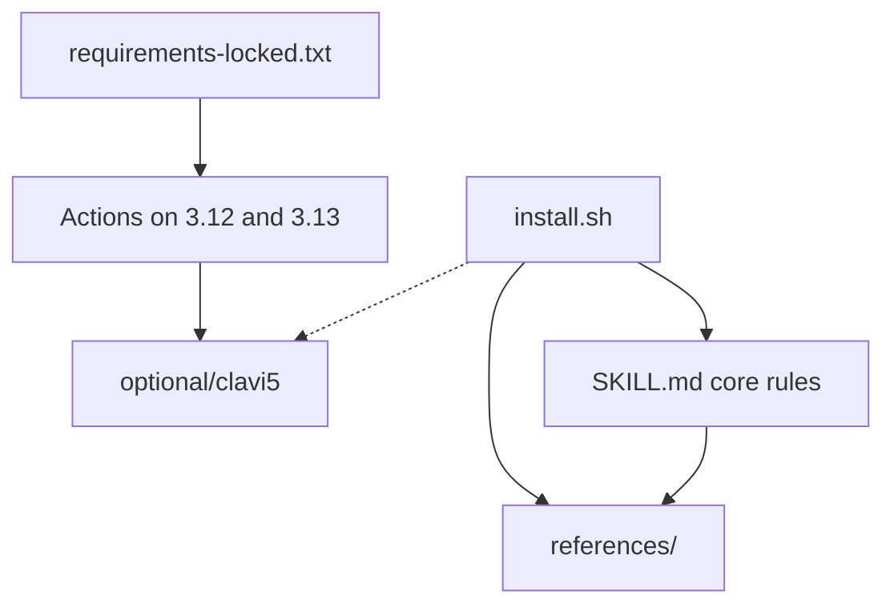

# v0.15.0 cleanup release - Plan

## Goal Capsule

- **Objective:** A maintainer can review one pull request for v0.15.0 in which a fresh linux x86_64 install works on Python 3.12 and 3.13, the manual matches the commands that exist, and offline CI is green.
- **Means:** Keep hash pinning and add the missing 3.13 wheel hashes (KTD1), run offline CI on 3.12 and 3.13 (KTD2), make static farm commands skip the ledger client (KTD3), copy linked references into the Muse install (KTD4), and follow S1–S5 for the parked checker, Clavi5 path, version string, manual split, and pointer.
- **Authority:** Product Contract requirements win on behavior. Planning Contract KTDs win on mechanism. Assumptions S1–S5 are the unconfirmed bets this plan executes.
- **Execution:** One implementation pass. Tests that already pin doc sentences stay green in the same change as the docs.
- **Stop:** Do not merge, tag, publish a GitHub release, or push to main. Do not comment on or close pull request #1. Do not add a trading command, a TrustLink client, or a signing bypass. Do not edit an external listing.
- **Ships:** The implementing agent opens the pull request. Terramike reviews it. Release tags stay with the maintainer.

---

## Product Contract

### Summary

v0.15.0 makes the published skill installable on Python 3.12 and 3.13, documents only commands that exist, and checks the offline suite in GitHub Actions. The lead becomes keyless XRPL research and safety, with trading second. Clavi5 leaves the installed tree. The owner reviews one pull request and publishes nothing from this change.

### Problem Frame

The skill on main is v0.14.1 in the README and has no CI. The locked requirements list only cp312 wheels for `websockets` and `wrapt`, so the documented install fails on Python 3.13. `SKILL.md` tells agents to run `xrpl-check` and to read `references/trustlink-data.json`; neither file exists. `bin/clavi5-beta` is an extra signer that `install.sh` copies because it copies all of `bin/`. The README says the manual is 971 lines; the file is 1165. Several docs say the proposer never sees a seed. Since v0.8.0, opt-in local commands in `xrpl-trade` store or, for backup, display a seed. Work since tag `v0.14.1` (`5a7e506`) has not been released.

### Key Decisions

- One review pull request, and no publish step in this change. (session-settled: user-directed — chosen over merging, tagging, publishing a GitHub release, or pushing to main: the owner reviews before anything is published). Governs R1.
- Pull request #1 is assessed in the new pull request's description and is otherwise left alone. (session-settled: user-directed — chosen over commenting on or closing it: the owner decides its fate). Governs R2.
- No new trading command and no new add-on. (session-settled: user-directed — chosen over expanding the skill: this is a cleanup). Governs R3.
- External listings stay as published. (session-settled: user-directed — chosen over updating HOL Guard or any other registry: this change does not edit listings). Governs R4.
- Fresh installs stay read-only until the typed `go live` ceremony. (session-settled: user-directed — chosen over a shortcut into signing: the existing ceremony is the gate). Governs R5.
- The public lead is keyless XRPL research and safety, with trading second. (session-settled: user-directed — chosen over a trading-first lead: the skill serves any agent). Governs R6.
- Docs describe read-only by default and opt-in local signing. (session-settled: user-directed — chosen over "never sees a seed" and "the only program that touches a seed": those sentences do not match the code after v0.8.0). Governs R7.
- The user-facing version is 0.15.0, with notes for the net change since v0.14.1 plus this cleanup. (session-settled: user-directed — chosen over leaving the README at v0.14.1: that tag does not contain the later commits). Governs R14.
- Clavi5 leaves the installed skill. (session-settled: user-directed — chosen over leaving `bin/clavi5-beta` on the install path: it is becoming a separate optional signer). Governs R11.

### Requirements

#### Release boundary

- R1. The change is one open pull request for Terramike to review. The branch is not merged, tagged, published as a GitHub release, or pushed to main.
- R2. That pull request's description says pull request #1 is an open conflicting draft from 2026-09-26, is not mergeable, and should be closed by the owner because it rewrites signing on a tree older than v0.14.1. It is not described as a merged patch. This change does not comment on or close #1.

#### Scope held still

- R3. The diff adds no trading command and no new add-on.
- R4. The diff does not change the HOL Guard profile URL or any other external listing or registry.

#### Safety words

- R5. A fresh install with no config file remains read-only until a person types `go live` at the existing prompt. The change adds no flag, env var, or config key that skips that prompt.
- R6. `README.md`, `SKILL.md`, and `llms.txt` open with keyless XRPL research and safety for any agent, and present trading as the second job.
- R7. `README.md`, `SKILL.md`, `llms.txt`, `SECURITY.md`, and `AGENTS.md` match the code on seeds. The propose path does not read a seed and does not submit. `xrpl-sign` is the only program that signs a proposal, and only with `--approve` of the exact hash, and it refuses while read-only. `wallet create` on mainnet is refused. `wallet create` on testnet stores a seed and does not display it. `wallet backup` displays the stored seed once when the selected network is not mainnet, requires the typed backup phrase, and warns that a chat transcript then contains the seed. It refuses when the selected network is mainnet. Autopilot enable can display a seed once through that same backup ceremony, including on mainnet, and then stores it. The faucet stores a testnet seed and does not print it. Giveaway setup writes the giveaway policy, stores a donation-wallet seed only when the operator pastes one, does not print it, and otherwise leaves that seed for vault injection. `setup` can store a seed for the network the operator types, including mainnet, and does not display it. A seed in `~/.xrpl/config.json` or `~/.xrpl/giveaway.json` blocks mainnet signing until `wallet forget-seed` removes it. Faucet files do not block. Adopting a config seed into autopilot does not clear that block. A missing config file is read-only. A config file with no `read_only` key is already live. The docs do not say the proposer never sees a seed, that `xrpl-sign` is the only program that touches a seed, that autopilot never prints a seed, or that mainnet never keeps a seed on disk. They still tell the operator not to paste a seed into chat.

#### Install and CI

- R8. `pip install -r requirements-locked.txt` succeeds on CPython 3.12 and 3.13 on linux x86_64, with hash checking still on and the existing package versions unchanged.
- R9. GitHub Actions runs the offline suite on Python 3.12 and 3.13 with no network dependency and no interactive prompt. The job sets `timeout-minutes`.

#### Commands and packaging

- R10. The manual does not tell an agent to run `xrpl-check`. No TrustLink checker, data file, or stub binary is added.
- R11. `install.sh` does not install `clavi5-beta`. The program and its test stay in the repo, outside `bin/` and `tests/`, and CI still runs that test.
- R12. A Muse install from `install.sh` contains `llms.txt` and every `references/` file the trimmed manual links to.

#### Docs and version

- R13. The README line count for `SKILL.md` matches `wc -l` after the trim. `SKILL.md` setup and the install step in `references/onboarding-wizard.md` both name `requirements-locked.txt`.
- R14. The README title is v0.15.0. `CHANGELOG.md` covers the net diff since tag v0.14.1 plus this cleanup. It does not give the hidden `fuzzy` command a release note, and it does not give Clavi5 usage steps.
- R15. `SKILL.md` keeps every sentence the current tests require it to contain, and it does not document a live autonomous mode or the hidden `fuzzy` command. `references/onboarding-wizard.md` still contains the word `autonomous` and does not give a setup procedure for a mode that is absent from this tree.

### Success Criteria

- The pull request's GitHub Actions runs are green on Python 3.12 and 3.13.
- An agent that follows `SKILL.md` is not sent to a missing `xrpl-check` binary or a missing TrustLink data file.
- The pull request description covers R2, the `xrpl-check` choice (S1), and what was not verified on a live XRPL network.

### Actors

- A1. Agent operator. Loads `llms.txt` and `SKILL.md`, runs keyless commands, and must not be told to sign or to type `go live`.
- A2. Human owner (Terramike). Reviews the pull request, types `go live` when they choose, and cuts any later tag.
- A3. CI. Runs the offline suite on a clean linux x86_64 runner.

### Key Flows

- F1. Install
  - **Trigger:** Operator follows the README or `install.sh`.
  - **Actors:** A1
  - **Steps:** Hash-checked install of the locked file. `install.sh` also copies `references/` and `llms.txt` and skips `optional/`.
  - **Covered by:** R8, R12
- F2. Offline check
  - **Trigger:** Push or pull request.
  - **Actors:** A3
  - **Steps:** Matrix of Python 3.12 and 3.13. Locked install. Each offline test file runs as a script. Network e2e files and `tests/test_wallet.py` are not started.
  - **Covered by:** R9

### Acceptance Examples

- AE1. On CPython 3.13, linux x86_64, `pip install -r requirements-locked.txt` installs `xrpl-py` 5.2.0 and does not report a hash mismatch for `websockets` or `wrapt`. Covers R8.
- AE2. The workflow does not execute `tests/test_e2e_testnet.py`, `tests/test_nft_send_e2e.py`, or `tests/test_wallet.py`. It does execute `tests/test_v060.py` and `tests/test_farm.py`. Covers R9.
- AE3. `SKILL.md` contains no `xrpl-check` usage line and no `trust.terramike.com` URL. Covers R10.
- AE4. After `install.sh`, the destination `bin/` has no `clavi5-beta`, and `references/farm.md` is present beside `bin/`. Covers R11, R12.

### Scope Boundaries

In scope: the lockfile hashes, the Actions workflow, the static farm dispatch, the install copy list, parking `xrpl-check`, moving Clavi5 off the install path, doc accuracy, the manual split, and the 0.15.0 notes.

Out of scope: merging or publishing; closing pull request #1; policy model edits (`POLICY_VERSION` stays 4); a TrustLink product; new trading commands; hidden-command documentation; editing the HOL Guard listing.

#### Deferred to Follow-Up Work

- Teach `tests/test_wallet.py` to script the backup prompt the way `tests/test_autopilot.py` already does, so that file can join the offline job. Do not delete it in this change.
- Add lock hashes for macOS, Windows, or aarch64. The lock stays linux x86_64, which is the platform it already claimed.
- Move Clavi5 to its own repository when that repository exists. This change only takes it off the installed skill.

### Sources

- Pip hash-checking mode allows several `--hash` values on one requirement so more than one archive of the same pinned version can install. https://pip.pypa.io/en/stable/topics/secure-installs/
- `requirements-locked.txt` pins `websockets==15.0.1` and `wrapt==2.4.1` to cp312 manylinux x86_64 wheels. `pycryptodome==3.23.0` is already an abi3 manylinux x86_64 wheel. The other pins are pure-Python wheels.
- `bin/xrpl-trade` `main()` calls `get_client()` before `cmd_farm`, including for `about` and `links`. `cmd_farm` itself says those two subcommands need no network. `get_client()` exits the process when no node answers.
- `install.sh` copies `SKILL.md`, `README.md`, `SECURITY.md`, both requirements files, the example JSON files, `bin/`, and `tests/`. It does not copy `references/` or `llms.txt`.
- `tests/test_v060.py`, `tests/test_onboarding.py`, and `tests/test_fuzzy.py` pin specific sentences in `README.md`, `SKILL.md`, `SECURITY.md`, `install.sh`, and `references/nft-pinata.md`.
- Pull request #1: https://github.com/terramike/xrpl-muse-skill/pull/1 — open draft, base `main`, head `fix/muse-security` at `552b155`, created and last updated 2026-09-26, mergeable state conflicting. Tag `v0.14.1` is later (`5a7e506`).
- No `docs/solutions/` corpus and no Compound Packs applied.

---

## Planning Contract

### Key Technical Decisions

- KTD1. Keep every current hash. On the existing `websockets==15.0.1` and `wrapt==2.4.1` lines, add the sha256 of the cp313 manylinux x86_64 wheel for that exact version. Confirm each digest by downloading that wheel and running `pip hash` in this change. Do not add a second requirement block for the same package. Do not change versions. Rewrite the file header so it describes linux x86_64 wheels for cp312 and cp313, and so it does not tell the reader to regenerate the whole file from one interpreter. (session-settled: user-directed — chosen over dropping hashes: both interpreters can install once the 3.13 wheels are listed). A pure-Python wheel hash for those two packages is optional and only added if `pip hash` confirms it and the 3.13 job still selects an allowed file. `pycryptodome` needs no new hash for stock CPython 3.13 on linux x86_64.
- KTD2. Add `.github/workflows/ci.yml`. Triggers are `push` and `pull_request` only. `ubuntu-latest`, `contents: read`, `timeout-minutes: 15`, `actions/setup-python` for 3.12 and 3.13. The workflow has no `secrets` context and no `pull_request_target` trigger. Install with `pip install -r requirements-locked.txt`. One `run` step exports a fresh `HOME`, unsets environment variables whose names contain `seed` in any case plus `PINATA_JWT` and `XRPLTO_API_KEY` without echoing values or `env`, and only then starts the test processes. An earlier step cannot keep that `HOME` or those unsets, because each step is a new shell, and `XRPL_DIR` is bound from the home directory when the common module is imported. Run each `tests/test_*.py` as a script, including `tests/test_onboarding.py` and `tests/test_fuzzy.py`. Do not use `unittest discover` and do not use `python3 -m unittest` on script modules. Never start `tests/test_e2e_testnet.py`, `tests/test_nft_send_e2e.py`, or `tests/test_wallet.py`. Do start `tests/test_v060.py`, `tests/test_farm.py`, `tests/test_readonly.py`, and the moved Clavi5 test by its new path. Do not run `xrpl-trade live`.
- KTD3. In `bin/xrpl-trade` `main()`, handle `farm about` and `farm links` before `get_client()`, the same way other local commands return early. `qualify`, `treasury`, and `dustings` still open a client. This is not a bake-off: skipping `tests/test_farm.py` would also make CI deterministic, and reversing either choice is cheap, but the command comments already say those two subcommands are local, and the test file is the behavior spec.
- KTD4. Extend `install.sh`'s explicit copy list with `references/` and `llms.txt`. Do not copy `optional/`. Do not replace the explicit list with a copy of the whole repo. Keep the hash-pinned install and the `TESTNET-ONLY` notice that `tests/test_v060.py` requires.

### Assumptions

- S1. Park `xrpl-check` instead of implementing it. The documented checker would need live redirect and domain-age data and would have to invent verdicts. Remove the usage block from the manual. Leave one sentence that the TrustLink checker is not part of this skill. Do not name verdict labels, do not link `trust.terramike.com`, and do not add a binary or `references/trustlink-data.json`. `references/trusted-links.md` stays as the curated link note that already exists. The `xrpl-check` usage block is deleted, not moved into a references file.
- S2. Move `bin/clavi5-beta` and `tests/test_clavi5_beta.py` to `optional/clavi5/` as siblings. Point the test loader at the program beside it. `install.sh` never copies that directory (KTD4).
- S3. Leave `bin/xrpl_common.py` `__version__` at `0.7.0`. That string is the unsupported-envelope error text, not the release version. Do not bump `POLICY_VERSION`.
- S4. Shorten `SKILL.md` by moving long bodies into `references/` and leaving a pointer plus any sentence R15 requires in `SKILL.md`. Move the NFT how-to, the favorites and radar how-to, the giveaway how-to, the menu-presentation rules, and the command catalog. Keep the lead, the HOL Guard paragraph and its existing URL, the read-only default, the propose-approve-sign rules, the ceremony, the safety rules, setup, and layout in `SKILL.md`. Replace the autonomous section with the same not-included sentence the command already prints, and make the wizard and `--help` say that too, without a setup procedure. Do not point `SKILL.md` at `references/fuzzy-lore.md`.
- S5. The installed README sentence says the beta client is not installed by `install.sh` and is not part of propose-approve-sign. It does not say the client sits outside the read-only gate. `optional/clavi5/README.md` says the program is not installed, does not sign Muse proposals, and stores no wallet seed. Neither file names a subcommand, a sign URL, an approval host, or the phrase "never sees a seed." Clavi5 does not appear in `SKILL.md`, `llms.txt`, `--help`, or as usage steps in `CHANGELOG.md`. A git checkout still contains the program.

### High-Level Technical Design

`install.sh` copies `references/` and does not copy `optional/clavi5`. CI installs from the lockfile, runs the offline tests, and runs the Clavi5 test by path.

### System-Wide Impact

Agents load `llms.txt` first and `SKILL.md` second. `llms.txt` keeps the safety spine in the file itself: fresh-install read-only, typed `go live` with no bypass, propose then human `--approve`, and no instruction to run `live` or to sign. A safety rule that moves into `references/` keeps a one-line pointer in both `llms.txt` and `SKILL.md`. The `llms.txt` entry for `SKILL.md` describes that core, not "every command." Signing stays human-gated. `xrpl-trade read-only` may stay agent-runnable. Hidden `fuzzy` stays out of help, menus, `SKILL.md`, `llms.txt`, and release notes. `llms.txt` today lists `fuzzy-lore.md`; U4 removes that line. The wizard does not point at `references/autonomous-setup.md`.

### Risks & Dependencies

- A wrong wheel digest fails the 3.13 job. KTD1 requires `pip hash` of the downloaded wheel in the same change, and AE1 is the proof.
- Moving a pinned sentence out of `SKILL.md` fails `tests/test_v060.py`, `tests/test_onboarding.py`, or `tests/test_fuzzy.py`. R15 names the sentences that stay.
- `farm qualify` still needs a node. Only `about` and `links` skip `get_client()`. `tests/test_farm.py` subprocess calls are `--help`, `farm about`, and `farm links`.
- Pull request #1 adds `.github/workflows/security.yml` on an old branch. A new workflow on this branch will conflict if that draft is rebased later. That conflict belongs to #1. This change does not rebase it.
- Live XRPL behavior of qualify, treasury, quotes, and submits is not re-verified here. The pull request description says so.
- A seed sentence that is shorter than R7 will ship a false safety story while `tests/test_v060.py` stays green. U4 checks R7's sentences in all five docs. The edit does not claim that autopilot never displays a seed, that mainnet never stores a seed, or that `setup` refuses mainnet.
- A CI step that echoes removed environment values writes them into the Actions log. KTD2 unsets those names without echoing them, uses `push` and `pull_request` only, and maps no `secrets` context. The unset, the fresh home directory, and the test processes share one workflow step. A test that restores its own environment cannot put a runner secret back into a later step.
- `install.sh` not copying `optional/` does not remove the program from a git checkout. The installed README sentence and `optional/clavi5/README.md` stay a non-use notice, per S5. Clavi5 does not check `is_read_only` and is not a substitute for propose, approve, and sign.

### Sequencing

U1 before U5, because the 3.13 job installs the lockfile. U2 before U5, because `tests/test_farm.py` must not dial. U3 before U4 and U5, because the manual and the workflow must use the new Clavi5 path and the extended installer. U4 before U5, so CI checks the doc pins after the trim.

---

## Implementation Units

### U1. Dual-Python hash pins

- **Goal:** The locked install works on CPython 3.12 and 3.13 on linux x86_64 without dropping hashes or changing versions.
- **Requirements:** R8
- **Dependencies:** none
- **Files:** `requirements-locked.txt`
- **Approach:** Follow KTD1. Add hashes only on the two existing requirement lines.
- **Execution note:** Smoke the install. Do not treat a hand-copied digest as done until `pip hash` of the downloaded wheel matches the line.
- **Patterns to follow:** The current backslash-continued `--hash` lines in `requirements-locked.txt`.
- **Test scenarios:**
  - On CPython 3.12, linux x86_64, installing the locked file succeeds and the cp312 websockets wheel remains an allowed hash.
  - On CPython 3.13, linux x86_64, installing the locked file succeeds (AE1).
  - The file still has exactly one requirement line per package name.
  - Package versions are unchanged from the current lock.
- **Verification:** Both interpreters install. The 3.13 proof may be the CI job from U5 when this workspace has only 3.12.

### U2. Static farm commands skip the client

- **Goal:** `farm about` and `farm links` print without contacting a node, so `tests/test_farm.py` is an offline spec.
- **Requirements:** R9
- **Dependencies:** none
- **Files:** `bin/xrpl-trade`, `tests/test_farm.py`
- **Approach:** Follow KTD3. Do not change qualify, treasury, or dustings.
- **Execution note:** The existing farm tests are the characterization. Change the dispatch, then run that file with no network.
- **Patterns to follow:** The early returns in `main()` for `favorites`, `watch`, and `wallet`.
- **Test scenarios:**
  - `farm about` and `farm links` print the issuer and the Farmers Union links when no ledger node is reachable.
  - `farm --help` still lists the subcommands and does not open a client.
  - `qualify`, `treasury`, and `dustings` still go through `get_client()`.
- **Verification:** `tests/test_farm.py` exits 0 without a multi-second node retry.

### U3. Clavi5 off the install path

- **Goal:** A normal install no longer ships the Clavi5 beta client, and the Muse install gains the reference files the manual needs.
- **Requirements:** R3, R9, R11, R12
- **Dependencies:** none
- **Files:** `bin/clavi5-beta`, `tests/test_clavi5_beta.py`, `optional/clavi5/clavi5-beta`, `optional/clavi5/test_clavi5_beta.py`, `optional/clavi5/README.md`, `install.sh`
- **Approach:** Follow S2, S5, and KTD4. Delete the old paths after the move. Update the test loader to the sibling program. The optional README is the short non-installed notice from S5.
- **Patterns to follow:** `install.sh`'s explicit copy list. The test's current `SourceFileLoader` usage, with the path updated.
- **Test scenarios:**
  - The moved test passes offline with HTTP mocked, as it does today.
  - `install.sh` still contains `requirements-locked.txt` and `TESTNET-ONLY`.
  - The copy list includes `references` and `llms.txt` and does not include `optional`.
  - After a dry reading of the copy list, `clavi5-beta` is not under the destination `bin/`.
  - `optional/clavi5/README.md` does not contain a subcommand name, an approval host, or the phrase "never sees a seed."
- **Verification:** The moved test exits 0. `bin/` no longer contains `clavi5-beta`.

### U4. Manual, signing words, and v0.15.0 notes

- **Goal:** README, the skill manual, and the changelog match the code and the 0.15.0 scope. The manual is shorter because the NFT, favorites and radar, giveaway, menu-presentation, and command-catalog how-tos move into `references/`. The `xrpl-check` usage block is removed, not relocated, and the autonomous section is replaced by the not-included sentence.
- **Requirements:** R4, R5, R6, R7, R10, R13, R14, R15
- **Dependencies:** U3
- **Files:** `README.md`, `SKILL.md`, `llms.txt`, `SECURITY.md`, `AGENTS.md`, `CHANGELOG.md`, `references/onboarding-wizard.md`, `references/nft-commands.md`, `references/favorites-and-radar.md`, `references/giveaway.md`, `references/menu-presentation.md`, `references/commands.md`, `bin/xrpl-trade`
- **Approach:** Follow S1, S3, S4, and S5. Recompute the README line count from the edited `SKILL.md`. `CHANGELOG.md` is the release notes. The README keeps a short "What's new in v0.15.0" that does not remove the deployment-profile sentences R15's tests require. Notes since `v0.14.1` come from the net diff: HOL Guard links already on main, artist-directory updates, NFT Radar, the public `fuzzy-deals` scanner, and this cleanup (install, CI, parked checker, Clavi5 leaving the install, doc corrections). Do not restate duplicate commits as separate features. Update `AGENTS.md` so the lead matches R6, the seed sentence matches R7, and the known-issue note says `tests/test_wallet.py` blocks on `input()` while `tests/test_v060.py` matches the current `spend state error` path. Replace the long `autonomous` help text with the not-included sentence already used when the import fails. Rewrite the autopilot disclosure so it does not say the seed is never printed. It states that generating a wallet, or backing up an adopted seed, runs the existing backup ceremony, which prints the seed once and requires the typed backup phrase, including on mainnet, and that a pasted seed stays on a hidden prompt. Keep the `ENABLE AUTOPILOT` confirmation.
- **Patterns to follow:** `SKILL.md` already points at `references/farm.md` for the long Farmers Union text. `cmd_farm_about` prints a missing-file line instead of inventing the page.
- **Test scenarios:**
  - `tests/test_v060.py` still finds `Testnet-safe by default`, the three deployment profile names, and `does **not** protect market value` in the README, and does not find `safe for humans too`.
  - `SKILL.md` still contains `nft-stage`, `nft-pin-and-propose`, `same-user local agent does **not** satisfy`, `references/onboarding-wizard.md`, `Finish your setup`, and `onboarding.json`, and does not contain `export PINATA_JWT`.
  - `SKILL.md` does not contain `references/fuzzy-lore`, `joelkatz mode`, `fuzzy wisdom`, `fuzzy dossier`, a backticked bare `fuzzy`, or `xrpl-trade fuzzy` not followed by a hyphen.
  - `references/onboarding-wizard.md` still discusses the `autonomous` step id and its install step names `requirements-locked.txt`.
  - `SKILL.md` has no `xrpl-check` usage line (AE3).
  - The README integer for the manual's line count equals the line count of `SKILL.md`.
  - `xrpl-trade autonomous` still exits with the not-included sentence, and `--help` does not describe a setup or tick loop.
  - The autopilot disclosure does not say the seed is never printed, and it still requires `ENABLE AUTOPILOT`.
  - `llms.txt` opens with keyless research and safety before trading, states the fresh-install read-only default and typed `go live`, and does not tell an agent to run `live` or to sign.
  - `llms.txt` and `SKILL.md` do not say the proposer never sees a seed, do not say `xrpl-sign` is the only program that touches a seed, and do not say autopilot never prints a seed or that mainnet never keeps a seed on disk.
  - `SKILL.md` still states that `xrpl-sign` refuses while read-only, and it still names `go live`.
  - `llms.txt` and `SKILL.md` contain no `xrpl-check`, no `trust.terramike.com`, no `references/trustlink-data.json`, no `clavi5`, and no `fuzzy-lore.md`.
  - `references/onboarding-wizard.md` does not point at `references/autonomous-setup.md` and does not give a setup or tick procedure.
  - `README.md` Clavi5 sentence matches S5: not installed, not part of propose-approve-sign, no subcommand and no "never sees a seed."
  - Every `references/*.md` path linked from `SKILL.md` exists.
- **Verification:** `tests/test_v060.py`, `tests/test_onboarding.py`, and `tests/test_fuzzy.py` exit 0. A reader of `CHANGELOG.md` can see v0.15.0 without a hidden-command note and without Clavi5 usage.

### U5. Offline CI workflow

- **Goal:** Pull requests run a deterministic offline suite on Python 3.12 and 3.13.
- **Requirements:** R1, R8, R9, R11
- **Dependencies:** U1, U2, U3, U4
- **Files:** `.github/workflows/ci.yml`
- **Approach:** Follow KTD2. The denylist is the three files in AE2. The Clavi5 test path is the one U3 created.
- **Execution note:** This is packaging. The proof is the workflow on the pull request, plus a local run of the same file list on the interpreter this workspace has.
- **Patterns to follow:** None in-repo. Use `actions/setup-python` and a temporary `HOME`, which is how `tests/test_farm.py` already isolates `~/.xrpl`.
- **Test scenarios:**
  - The workflow matrix is Python 3.12 and 3.13 on `ubuntu-latest` with `timeout-minutes` set.
  - The job installs `requirements-locked.txt` and does not install `requirements.txt` alone.
  - The runner starts `tests/test_readonly.py`, `tests/test_v060.py`, `tests/test_farm.py`, `tests/test_onboarding.py`, and `tests/test_fuzzy.py`.
  - The runner does not start the three excluded files in AE2.
  - The runner starts `optional/clavi5/test_clavi5_beta.py`.
  - The workflow file has no `pull_request_target` trigger and no `secrets` context. The unset and the fresh `HOME` are in the same `run` step as the tests, and that step does not echo `XRPL_SEED`, `PINATA_JWT`, or `XRPLTO_API_KEY`.
- **Verification:** Local offline files exit 0. The pull request's Actions checks are green (R9, Success Criteria).

---

## Verification Contract

Run the affected files as scripts, not via `unittest discover`. `python3 -m unittest` on a script module that defines no `TestCase` can exit 5 after the script body has already passed.

Local, no network:

- `python3 tests/test_readonly.py`
- `python3 tests/test_farm.py`
- `python3 tests/test_v060.py`
- `python3 tests/test_onboarding.py`
- `python3 tests/test_fuzzy.py`
- `python3 tests/test_eco.py`
- `python3 tests/test_v04.py`
- `python3 optional/clavi5/test_clavi5_beta.py` after U3
- The same script loop the workflow uses, excluding the three files in AE2

Install smoke on the local interpreter: `pip install -r requirements-locked.txt` in a fresh environment. Python 3.13 is proved by the Actions job when it is not installed locally.

Do not run `tests/test_e2e_testnet.py`, `tests/test_nft_send_e2e.py`, or `tests/test_wallet.py` in this verification. Do not start a live ceremony.

## Definition of Done

- U1 through U5 are complete and their test scenarios pass.
- The pull request is open, CI on it is green, and the description states the `xrpl-check` choice, the pull request #1 assessment, and that live XRPL network behavior was not re-verified.
- The branch is not merged, tagged, published as a GitHub release, or pushed to main.
- No seed, token, or other secret appears in the diff, the workflow, or the pull request text.
- Experimental files from abandoned approaches are not left in the diff.
